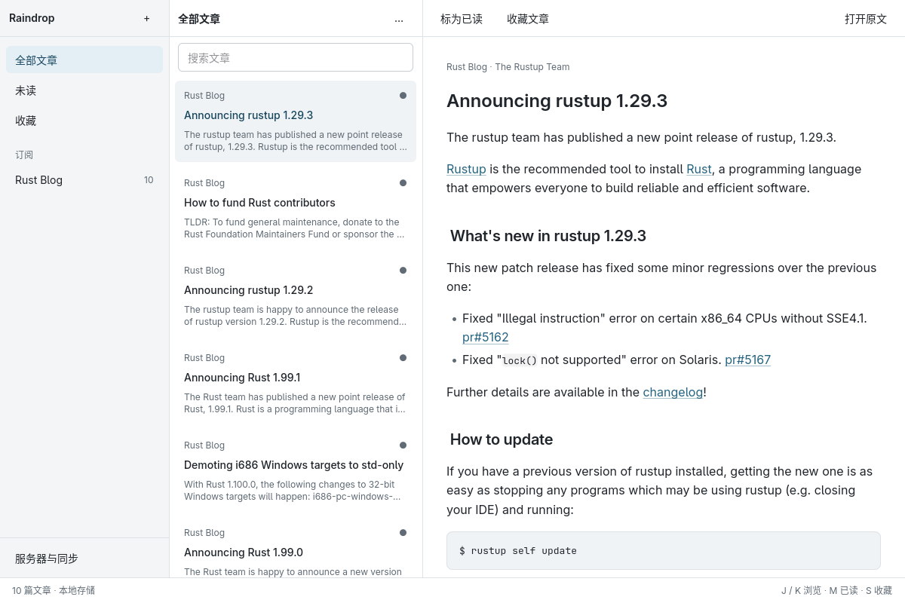
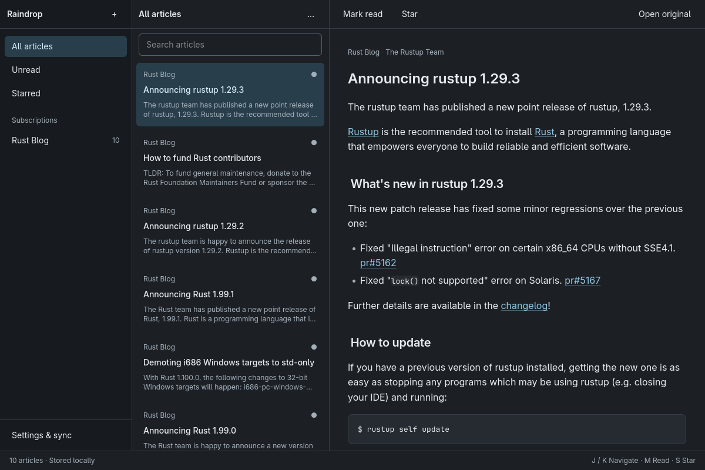
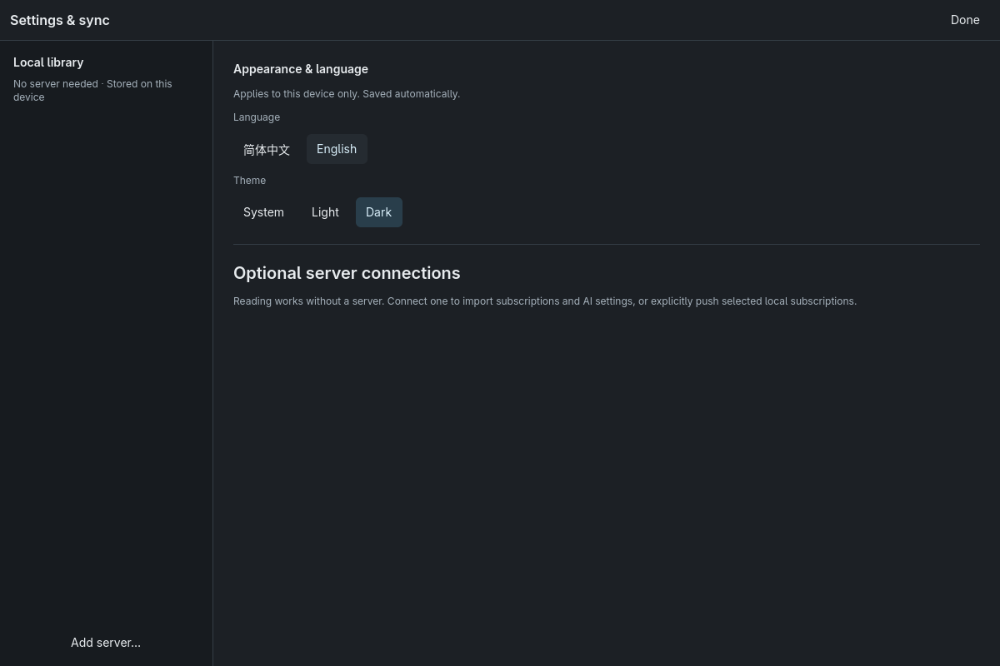

# Raindrop Desktop

Rust NSH 原生阅读器，独立于 Web 服务端发布。当前为 `0.1.1` 开发预览，
不是 Web 功能完全对等版，也不承诺旧服务端的可靠双向同步。

## 运行

```sh
cd desktop
cargo run --locked
```

无需 Docker、外部服务或登录即可本地阅读。核心在进程内运行，不监听端口。
应用数据库、任务及导入关系存入操作系统应用数据目录，不放在代码仓库。
同一资料库只允许一个实例运行。迁移沿用服务端核心，但请勿直接复用服务端数据目录。
数据库与恢复设计见 [DDIA 存储说明](../docs/desktop-storage.md)。
便携包中也附带 `docs/desktop-storage.md` 和原生截图，可离线查看恢复边界及界面。

便携 ZIP 解压后，Linux 在解压目录运行 `./raindrop-desktop`，Windows 运行
`raindrop-desktop.exe`；macOS 打开 `Raindrop Desktop.app`。当前包尚未完成发行签名与公证，
只作为开发预览验证，不提供绕过系统安全检查的安装流程。

- Linux：GTK 4.14+，构建还需 GTK 开发包、pkg-config、Clang、CMake、Perl。
- macOS：14+、Xcode Command Line Tools。
- Windows：Windows 10 1809+，MSVC Rust、Visual Studio C++ 工具、CMake、Perl。
- 工具链固定为 Rust 1.99.1；NSH 固定为 0.4.0。`nsh` CLI 非必需，
  使用 CLI 时必须匹配 0.4.0。不要使用更新 CLI 自动改写依赖。

发布构建复用了服务端库的构建脚本，因此还需先构建嵌入资源：

```sh
npm --prefix web ci --ignore-scripts
npm --prefix web run build
cd desktop
cargo build --release --locked
```

以上命令从仓库根目录执行。嵌入资源是共享核心的构建要求，不会用于渲染桌面 UI。
官方发布还必须配置现有官方插件签名环境变量，不能将开发签名当作正式签名。

## 当前能力

- 原生三栏、可调整宽度、窄窗口导航、虚拟列表、原生文章排版和系统外链。
- 原生设置中的「外观与语言」支持简体中文 / English，浅色 / 深色 / 跟随系统。
  切换即时生效，保留搜索、选中文章和当前阅读视图；成功保存后才更新界面，重启自动恢复。
  设置仅存此设备，与远端同步记录分表保存；同步记录损坏不影响主题和语言。
- 本地订阅添加、退订、后台抓取、搜索、未读筛选、已读和收藏。
- `Mod+F` 搜索、`Mod+R` 重新载入、`J/K` 导航、`M` 已读、`S` 收藏。
  输入框内保留正常文字输入。
- 可添加多个远端；HTTPS 必需，只有回环地址允许 HTTP，拒绝跨站重定向。
- 显式导入远端订阅和 AI 配置参考，按服务器与账户隔离映射。
  相同 Feed 复用本地订阅，不覆盖已有标题、分类和顺序。
- 明确选择本地订阅后才能「推送新增订阅（兼容模式）」；只发送 URL。
  发送意图持久化，结果未知只核对，不自动重发；远端删除不会因此被复活。
- 退订只影响本地，保留来源抑制记录；移除连接不会删除已经导入的本地订阅。

## 必须了解的边界

- 兼容导入与新增推送不是完整镜像：不传播编辑、分类变更、排序、删除或阅读状态。
  双向同步需要服务端配置修订、稳定快照、墓碑及幂等回执，当前入口明确不可用。
- Provider 接口不返回 API 密钥；导入的 AI 配置只是远端引用。
  尚未关联远端文章身份，桌面端不会执行远端 AI 或静默回退到本地 Provider。
- 远端密码、Cookie、CSRF 不持久化；重启后重新登录。
  尚未集成系统凭据保险库。本地共享核心的加密 Provider 存储使用私有目录中的密钥文件，
  不是抵御拥有当前系统账户权限的攻击者的保险库；备份时必须同时保留密钥文件。
- 文章远端图片暂显示占位，避免默认追踪请求；可以通过系统浏览器打开原文。
- 当前不含原生 OPML、完整 AI/MCP/备份设置，不等同于 Web 功能全部已实现。
- Linux 已本地编译、测试及视觉检查；macOS/Windows 仍需对应平台构建和验证，
  不把 Linux 截图当作跨平台验收。签名、公证、安装器和自动更新尚未完成。

## 实际界面

2026-11-11，Linux 原生窗口，1200 × 800，使用隔离本地资料库中的真实 Rust Blog 订阅。
截图与 Web 版分开维护；在仓库根目录 [README](../README.md#界面预览) 中也有展示。







## 验证与发布

```sh
cd desktop
cargo fmt --check
cargo check --all-targets --locked
cargo test --locked
cargo clippy --all-targets --locked -- -D warnings
```

独立版本在 `desktop/Cargo.toml` 和 `desktop/nsh.json`；只使用
`raindrop-desktop-v*` tag。不要修改服务端版本、删除既有服务端 tag 或触发 Docker 发布。
在平台验证、独立审核和发布签名通过前，不创建正式桌面 release。
